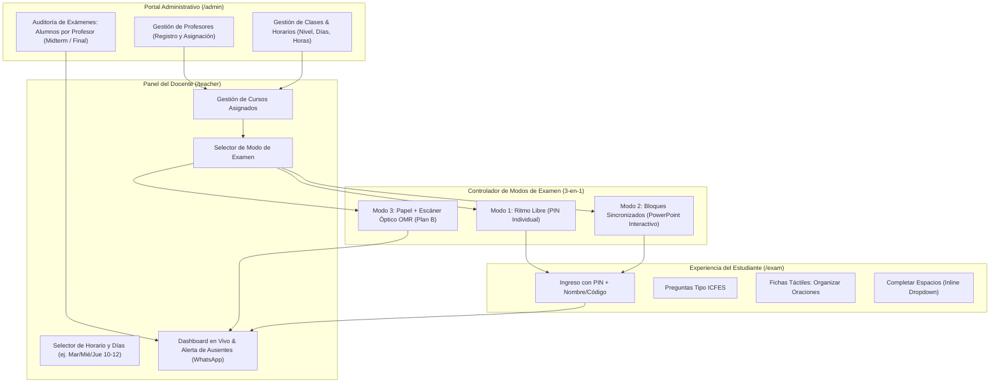

# Plan de Implementación: Sistema Modular de Evaluaciones para Academia de Lenguas

## 1. Resumen Ejecutivo y Alcance
El objetivo es sustituir la práctica actual de proyectar presentaciones de PowerPoint con 30 preguntas estáticas (5 por diapositiva) para exámenes intermedios y finales en una academia de idiomas.

El sistema resuelve:
- El desfase de tiempos y estrés de los alumnos por ritmos de avance desiguales.
- El riesgo de copia al proyectar las mismas 5 preguntas simultáneamente.
- El desgaste operativo de calificar a mano hojas de 30 preguntas.
- La gestión de cursos reducidos regulares (6 a 8 estudiantes) y clases particulares (personalizadas 1-a-1 o semipersonalizadas).
- La estructura curricular real de la academia: **20 subniveles (1A a 10B)** y la fase final **Training** (enfocada en el examen internacional APTIS).

---

## 2. Arquitectura General del Sistema

---

## 3. Estado de Módulos (Corte de Avance)

### ✅ Fase 1: Backend MVP & Modelo de Datos Completo (100% COMPLETADO)
- **Infraestructura Base:** NestJS Boilerplate configurado sobre PostgreSQL 17 local con TypeORM.
- **Módulo Académico:** Idiomas y 21 niveles (1A a 10B + TRAINING) con endpoints y seeds.
- **Módulo de Cursos y Matrículas:** Modalidades de curso (`REGULAR_GROUP`, `PERSONALIZED_1ON1`, `SEMI_PERSONALIZED`), horarios estructurados por días (`MONDAY`..`SUNDAY`) y rangos, matrículas de alumnos y filtro docente por día.
- **Módulo de Exámenes y Preguntas:** Banco de preguntas con validación estricta de regla Training (prohibido examen Final para Training), soporte completo de los 4 tipos de reactivos (ICFES, Sentence Scramble, Fill in the Blank / Cloze dropdown, Sentence Completion), y endpoint anti-copia (`/student-view`) que oculta respuestas y baraja opciones.
- **Módulo de Sesiones 3-en-1 & Calificación Automática:** 
  - Generación de PIN de clase.
  - Precarga automática de lista de asistencia oficial en estado `PENDING`.
  - Check-in en tiempo real (`IN_PROGRESS`).
  - Dashboard de monitoreo docente con generación de link directo a WhatsApp para ausentes.
  - Motor de calificación automática para los 4 tipos de preguntas.
  - Controlador de bloques sincronizados (`advance-block`).
  - Cierre de sesión y asignación automática de `No Presentó (N/P)` con nota `0.00` para ausentes.

### ✅ Fase 2: Frontend Base bajo Estándar Hallmark v2 (100% COMPLETADO)
- Aplicación cliente en `frontend/` (Next.js 14 App Router, TypeScript, Tailwind CSS) bajo el estándar **Hallmark (`nutlope/hallmark`)**.
- Tokens de diseño editorial: `--color-paper`, `--color-ink`, `--color-accent` (The Floor: cero gradientes genéricos, cero cards anidadas, `:focus-visible` explícito sin `transition: all`).
- 4 reactivos táctiles interactivos:
  - Selector táctil tipo ICFES grande con borde cobalto activo.
  - Fichas táctiles interactivas con modelo Tap-to-Order (Sentence Scramble).
  - Menús desplegables incrustados armónicamente en el texto (*inline* Cloze / Dropdown).
  - Caja de texto limpia para completar la oración.
- Guardia anti-copia en cliente (`AntiCheatGuard.tsx`) con detección de pérdida de pestaña.
- Flujo de estudiante: Lobby de PIN (`/exam/join`), Runner activo (`/exam/[sessionId]`), y Entrega con nota calculada (`/exam/[sessionId]/result`).

### ✅ Fase 3: Portal Docente y Monitor en Vivo (100% COMPLETADO)
- Dashboard docente (`/teacher`): tarjetas de cursos asignados filtrables por día.
- Modal de apertura de examen con selector de plantilla oficial según nivel y modo de examen.
- Monitor en vivo (`/teacher/sessions/[id]`): PIN en grande, métricas en vivo, lista de asistencia con polling cada 3.5s, **botón directo a WhatsApp para ausentes**, avance manual de bloque y cierre de sesión con auto-NP.

### ✅ Fase 4: Login Unificado y Fondo `<ScrollExpand />` (React Bits) (100% COMPLETADO)
- Inicio de sesión unificado en `/` para los 3 roles (`Admin`, `Docente`, `Estudiante`) con enrutamiento automático.
- Integración de `<ScrollExpand />` (React Bits) con la fotografía de la Biblioteca Peabody.
- Activación dinámica al hacer clic en la casilla de correo electrónico, expandiéndose de marco centrado curvo a pantalla completa (*full-bleed*) con velo de contraste oscuro.
- Botones de acceso rápido Demo (Docente, Estudiante, Admin).

### ✅ Fase 5: Portal Administrativo Completo (`/admin`) (100% COMPLETADO)
- **Ruta dedicada `/admin`:** Redirección exclusiva al iniciar sesión como Administrador (`admin@example.com` / `secret`).
- **Auditoría de Exámenes por Profesor:** Métricas globales, selector de docente y selector de tipo de examen (*Midterm* / *Final*). Tabla interactiva que indica cuántos estudiantes estuvieron con un profesor en cada examen intermedio o final, tasa de asistencia, ausentes (N/P), promedio obtenido y desglose desplegable de alumnos.
- **Gestión de Profesores:** Registro de docentes mediante modal accesible (nombre, apellido, correo institucional, contraseña cifrada y teléfono). Fichas de profesores con cursos y horarios a cargo.
- **Gestión de Clases & Horarios:** Registro de cursos vinculando nivel (1A a 10B + Training), modalidad, docente titular, selección múltiple de días, horario de inicio y fin, aula y capacidad máxima.

### ✅ Fase 6: Control de Acceso por Roles (`RoleGuard`) & `<EchoText />` (100% COMPLETADO)
- **Seguridad en Rutas:** `/admin` restringido únicamente al rol Admin; `/teacher` restringido a Docente y Admin.
- **Componente `<EchoText />` (React Bits):** Animación de eco dinámico en cascada física para el mensaje de `"ACCESO DENEGADO"`.
- **Diseño Editorial de Seguridad (Hallmark v2):** Bloqueo con explicación clara del rol actual, botón contextual para regresar a la sala de examen correspondiente (`/exam/join`) y botón para cambiar de cuenta.

---

## 4. Próximos Módulos (Hoja de Ruta)

1. **Proyector de Bloques Sincronizados (Modo 2):**
   - Pantalla completa para el aula (`/teacher/sessions/[id]/projector`).
   - Temporizador visual con cuenta regresiva por bloque (5 preguntas).
   - Contador en vivo de alumnos que han enviado y avance automático sincrónico.
2. **Modo Papel + Escáner Óptico OMR (Modo 3 - Plan B de Contingencia):**
   - Generación de PDF imprimible con hoja de respuestas tipo ICFES (30 burbujas).
   - Módulo de lectura OMR con cámara del docente.
3. **Gestión de Exámenes Extemporáneos / Supletorios:**
   - Habilitación de sesión individual para estudiantes con `N/P`.
4. **Reportes y Exportación Consolidada:**
   - Consolidado de notas por nivel y exportación CSV/Excel para el sistema institucional.
