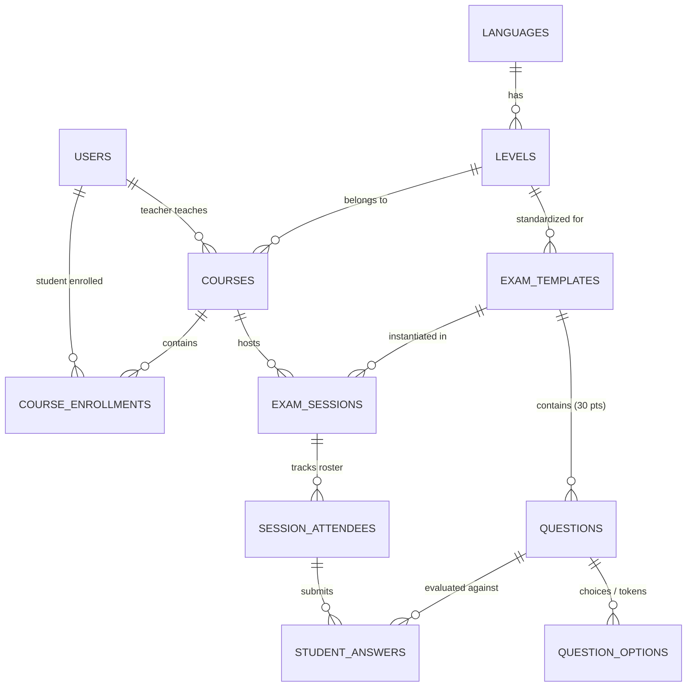

# Especificación del Modelo de Datos (MVP)

Sistema Modular de Evaluaciones para Academia de Idiomas.

---

## Diagrama Entidad-Relación (ERD)

---

## 1. Dominio de Usuarios y Roles (Auth & Access)

### `users`
Almacena todos los actores del sistema (Administradores/Coordinadores, Profesores y Estudiantes).

| Campo | Tipo | Restricciones | Descripción |
| :--- | :--- | :--- | :--- |
| `id` | UUID | PK, NOT NULL | Identificador único universal. |
| `name` | VARCHAR(120) | NOT NULL | Nombre completo. |
| `email` | VARCHAR(150) | UNIQUE, NULLABLE | Correo electrónico (obligatorio para coordinadores y profesores). |
| `student_code` | VARCHAR(50) | NULLABLE | Código interno de matrícula del estudiante en la academia. |
| `phone_number` | VARCHAR(25) | NULLABLE | Número móvil con prefijo internacional para envío de WhatsApp. |
| `role` | ENUM | NOT NULL | `ADMIN_COORDINATOR`, `TEACHER`, `STUDENT`. |
| `password_hash` | VARCHAR(255) | NULLABLE | Clave cifrada (los estudiantes pueden acceder vía PIN/Código en MVP). |
| `is_active` | BOOLEAN | DEFAULT TRUE | Estado de la cuenta. |
| `created_at` | TIMESTAMP | DEFAULT NOW() | Fecha de registro. |

---

## 2. Dominio Académico (Cursos, Horarios y Niveles)

### `languages`
Catálogo de idiomas impartidos por la academia.

| Campo | Tipo | Restricciones | Descripción |
| :--- | :--- | :--- | :--- |
| `id` | SERIAL | PK | Identificador del idioma. |
| `name` | VARCHAR(60) | NOT NULL | Nombre (ej. "Inglés", "Francés", "Alemán"). |
| `code` | VARCHAR(10) | UNIQUE, NOT NULL | Código ISO/Nemotécnico (ej. "EN", "FR", "DE"). |

### `levels`
Estructura curricular de 20 subniveles (1A a 10B) más la fase final Training (preparación APTIS).

| Campo | Tipo | Restricciones | Descripción |
| :--- | :--- | :--- | :--- |
| `id` | SERIAL | PK | Identificador del nivel. |
| `language_id` | INT | FK -> `languages.id` | Idioma al que pertenece. |
| `code` | VARCHAR(15) | NOT NULL | Código ('1A', '1B', ..., '10B', 'TRAINING'). |
| `name` | VARCHAR(100) | NOT NULL | Nombre descriptivo (ej. "Nivel 5B", "Fase Training"). |
| `level_type` | ENUM | NOT NULL | `REGULAR` (1A a 10B), `TRAINING_APTIS` (Fase final). |
| `has_final_exam`| BOOLEAN | NOT NULL | `TRUE` para 1A-10B; `FALSE` para Training (evaluación final es APTIS). |
| `order_index` | INT | NOT NULL | Secuencia curricular (1 para 1A, 2 para 1B ... 21 para Training). |

### `courses`
Representa un grupo o aula asignada a un docente con horario y modalidad específica.

| Campo | Tipo | Restricciones | Descripción |
| :--- | :--- | :--- | :--- |
| `id` | UUID | PK | Identificador único del curso. |
| `level_id` | INT | FK -> `levels.id` | Nivel curricular del curso. |
| `teacher_id` | UUID | FK -> `users.id` | Profesor titular asignado. |
| `course_name` | VARCHAR(120) | NOT NULL | Nombre (ej. "Inglés 4A - Mar/Mié/Jue Mañana"). |
| `course_modality`| ENUM | NOT NULL | `REGULAR_GROUP`, `PERSONALIZED_1ON1`, `SEMI_PERSONALIZED`. |
| `capacity` | INT | NOT NULL | 1 (Personalizado), 2-3 (Semipersonalizado), 8 (Grupo regular). |
| `schedule_days`| JSONB / VARCHAR | NOT NULL | Días de clase (ej. `["TUESDAY", "WEDNESDAY", "THURSDAY"]`). |
| `start_time` | TIME | NOT NULL | Hora de inicio (ej. 10:00:00). |
| `end_time` | TIME | NOT NULL | Hora de finalización (ej. 12:00:00). |
| `classroom` | VARCHAR(50) | NULLABLE | Aula asignada o enlace virtual. |
| `term` | VARCHAR(30) | NOT NULL | Ciclo o periodo (ej. "2026-I"). |
| `is_active` | BOOLEAN | DEFAULT TRUE | Estado operativo del curso. |

### `course_enrollments`
Asociación de estudiantes inscritos en cada grupo (Roster oficial).

| Campo | Tipo | Restricciones | Descripción |
| :--- | :--- | :--- | :--- |
| `id` | UUID | PK | Identificador de inscripción. |
| `course_id` | UUID | FK -> `courses.id` | Curso matriculado. |
| `student_id` | UUID | FK -> `users.id` | Estudiante matriculado. |
| `enrollment_status` | ENUM | NOT NULL | `ACTIVE`, `DROPPED`, `COMPLETED`. |

---

## 3. Dominio de Exámenes y Reactivos (Banco Oficial)

### `exam_templates`
Exámenes centralizados y estandarizados por la Coordinación Académica.

| Campo | Tipo | Restricciones | Descripción |
| :--- | :--- | :--- | :--- |
| `id` | UUID | PK | Identificador de plantilla de examen. |
| `level_id` | INT | FK -> `levels.id` | Nivel asignado. |
| `exam_type` | ENUM | NOT NULL | `MIDTERM` (Parcial intermedio), `FINAL` (Examen final). |
| `title` | VARCHAR(120) | NOT NULL | Título oficial (ej. "Midterm Exam 5B - Grammar & Syntax"). |
| `total_questions`| INT | DEFAULT 30 | Cantidad total de preguntas (estándar 30). |
| `duration_minutes`| INT | DEFAULT 45 | Duración límite sugerida en minutos. |
| `created_by` | UUID | FK -> `users.id` | Coordinador creador. |

*Nota de validación:* Para niveles con `level_type = TRAINING_APTIS`, solo se admite la creación de plantillas con `exam_type = MIDTERM`.

### `questions`
Cada uno de los 30 puntos o reactivos de la evaluación.

| Campo | Tipo | Restricciones | Descripción |
| :--- | :--- | :--- | :--- |
| `id` | UUID | PK | Identificador del reactivo. |
| `exam_template_id`| UUID | FK -> `exam_templates.id` | Plantilla a la que pertenece. |
| `type` | ENUM | NOT NULL | `ICFES_MULTIPLE_CHOICE`, `SENTENCE_SCRAMBLE`, `FILL_IN_BLANK`. |
| `prompt` | TEXT | NOT NULL | Enunciado o instrucción principal. |
| `context_text` | TEXT | NULLABLE | Texto o microdiálogo de soporte. |
| `block_number` | INT | NOT NULL | Bloque (1 a 6) para el modo sincronizado (5 preguntas/bloque). |
| `order_index` | INT | NOT NULL | Posición original (1 a 30). |
| `points` | DECIMAL(4,2)| DEFAULT 1.00 | Valor ponderado de la pregunta. |

### `question_options`
Opciones de respuesta, palabras a ordenar o valores de desplegables.

| Campo | Tipo | Restricciones | Descripción |
| :--- | :--- | :--- | :--- |
| `id` | UUID | PK | Identificador de la opción. |
| `question_id` | UUID | FK -> `questions.id` | Pregunta asociada. |
| `content` | TEXT | NOT NULL | Texto de la alternativa o palabra/token a ordenar. |
| `is_correct` | BOOLEAN | DEFAULT FALSE | Indica si es la opción correcta. |
| `correct_position`| INT | NULLABLE | Posición requerida (1, 2, 3...) para ordenar oraciones. |

---

## 4. Dominio de Sesiones en Vivo, Asistencia y Calificaciones

### `exam_sessions`
Representa la instancia del examen ejecutada en el aula por el profesor.

| Campo | Tipo | Restricciones | Descripción |
| :--- | :--- | :--- | :--- |
| `id` | UUID | PK | Identificador de la sesión en vivo. |
| `course_id` | UUID | FK -> `courses.id` | Curso en el que se aplica. |
| `exam_template_id`| UUID | FK -> `exam_templates.id` | Examen aplicado. |
| `teacher_id` | UUID | FK -> `users.id` | Docente supervisor. |
| `session_pin` | VARCHAR(8) | NOT NULL | Código PIN proyectado (ej. "749-102"). |
| `mode` | ENUM | NOT NULL | `FREE_PACE`, `SYNC_BLOCKS`, `PAPER_OMR`. |
| `status` | ENUM | NOT NULL | `WAITING_LOBBY`, `IN_PROGRESS`, `FINISHED`, `CANCELLED`. |
| `current_block`| INT | DEFAULT 1 | Bloque activo (1 a 6) si opera en modo bloques sincronizados. |
| `started_at` | TIMESTAMP | NULLABLE | Momento de inicio de la prueba. |
| `ended_at` | TIMESTAMP | NULLABLE | Momento de cierre oficial por el profesor. |

### `session_attendees`
Control del listado de estudiantes (asistencia en vivo, ausentes y nota final).

| Campo | Tipo | Restricciones | Descripción |
| :--- | :--- | :--- | :--- |
| `id` | UUID | PK | Identificador del asistente. |
| `session_id` | UUID | FK -> `exam_sessions.id` | Sesión activa. |
| `student_id` | UUID | FK -> `users.id` | Estudiante del roster. |
| `attendance_status`| ENUM | NOT NULL | `PENDING`, `IN_PROGRESS`, `COMPLETED`, `ABSENT`. |
| `whatsapp_notified`| BOOLEAN | DEFAULT FALSE | Registro de si se activó el aviso de inasistencia. |
| `total_score` | DECIMAL(4,2)| NULLABLE | Calificación definitiva calculada. |
| `is_makeup` | BOOLEAN | DEFAULT FALSE | Indica si es examen extemporáneo/supletorio. |
| `started_at` | TIMESTAMP | NULLABLE | Hora de ingreso efectivo del alumno. |
| `submitted_at` | TIMESTAMP | NULLABLE | Hora de envío del examen. |

### `student_answers`
Detalle de respuestas enviadas por cada estudiante para analíticas.

| Campo | Tipo | Restricciones | Descripción |
| :--- | :--- | :--- | :--- |
| `id` | UUID | PK | Identificador del registro de respuesta. |
| `session_attendee_id`| UUID | FK -> `session_attendees.id` | Alumno que respondió. |
| `question_id` | UUID | FK -> `questions.id` | Pregunta respondida. |
| `student_response` | JSONB / TEXT | NOT NULL | Opción seleccionada o array ordenado de palabras. |
| `is_correct` | BOOLEAN | NOT NULL | Validación automática del sistema. |
| `score_earned` | DECIMAL(4,2)| NOT NULL | Puntos obtenidos en el punto. |
